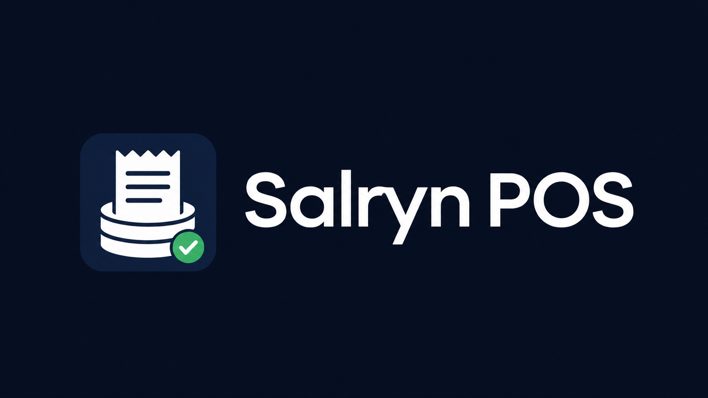

<p align="center">
  
</p>

<h1 align="center">Salryn POS</h1>

<p align="center">
  <strong>Offline-ready point-of-sale and inventory software for MSMEs.</strong>
</p>

<p align="center">
  Track sales. Track inventory. Preserve receipts. Keep operating without continuous internet access.
</p>

---

## Overview

**Salryn POS** is a Windows-based point-of-sale and retail operations platform developed for micro, small, and medium enterprises.

It centralizes sales transactions, product records, inventory levels, stock movements, receipts, reporting, user activity, and local backup operations in one store system.

Salryn is designed for businesses transitioning from notebooks, spreadsheets, calculators, or disconnected applications. Completed sales are connected directly to inventory updates and reporting, reducing repetitive encoding and delayed stock information.

**No continuous internet connection is required for normal store operations.**

Internet access may still be used for downloading installers, receiving updates, accessing documentation, or obtaining support.

---

## Core Capabilities

- Point-of-sale checkout and sales recording
- Automatic inventory deduction for completed sales
- Product, barcode, SKU, unit, category, and brand management
- Stock-in and controlled stock-adjustment workflows
- Low-stock and out-of-stock monitoring
- Sales history and receipt preservation
- Receipt reprinting without modifying the original sale
- Daily, weekly, monthly, and product-level reporting
- Cashier, shift, and user activity tracking
- Role-based access controls
- Audit records and CSV export
- Local backup and restore
- Offline operation without continuous internet access
- Supported additional-terminal access for selected local workflows

---

## Upcoming Optional Add-on: Salryn Utang Ledger

Salryn POS is preparing an optional Utang Ledger module for stores that need structured accounts-receivable and customer-credit tracking.

Planned capabilities include:

- A customer account for each credit customer
- Required customer full name
- Phone number field
- Automatic date and time recording
- Identification of the user or cashier who recorded the transaction
- Optional notes
- Due-date tracking
- Cash, Utang, and Cash + Utang checkout support
- Customer balance tracking
- Payment collection tracking
- Recurring credit history for each customer
- Outstanding-balance and overdue visibility

Utang records will remain separate from cash received, while later collections will reduce the customer balance without creating another sale.

This module remains under development and validation and is not included in the currently downloadable installer.

---

## Why Salryn POS

Many small stores still rely on notebooks, calculators, spreadsheets, or older systems that separate sales from inventory records.

Salryn provides one local platform for daily store operations:

```text
Sell products.
Track inventory.
Review sales.
Preserve receipts.
Back up store data.
Keep operating even without internet.
```

---

## Recommended Setup

### Single Workstation

Suitable for a small store using one computer as its main POS station.

```text
Windows 10 or Windows 11, 64-bit
Intel Core i3 6th generation or newer
8 GB RAM
128 GB SSD
1366×768 display or better
Stable power source
```

### Host with Additional Terminals

Suitable for stores using one main Windows host and supported secondary devices for selected cashier or review workflows.

Recommended host:

```text
Windows 10 or Windows 11, 64-bit
Intel Core i5 8th generation or newer
16 GB RAM
256 GB SSD
Stable wired or Wi-Fi local network
UPS recommended
```

Additional terminals may use supported Windows devices, phones, or tablets depending on the approved deployment configuration and workflow.

---

## Data Storage

Salryn POS stores operational data locally on the store computer.

Stored data may include:

- Local database
- Receipt files
- Backups
- Exports
- Logs
- Configuration
- License state

Store data should be protected through documented backup procedures. The Salryn data directory should not be deleted or modified unless instructed during authorized support.

---

## Included Workflows

### Sales

- POS checkout
- Cash payment flow
- Sales history
- Receipt review
- Receipt reprint
- Daily sales visibility

### Inventory

- Product catalog
- Barcode and SKU support
- Unit-of-measure support
- Stock-in
- Stock adjustment
- Low-stock visibility
- Stock-movement review

### Reports and Records

- Operational dashboard
- Sales summaries
- Audit records
- CSV export
- Receipt files

### Store Safety

- Local backup support
- Restore support
- Local data storage
- Installer-based Windows application setup

### Expansion

- Additional-terminal access
- Supported phone or tablet access for selected workflows
- Local-network deployment for approved store configurations

---

## Scope and Limitations

Salryn POS does not automatically include:

- POS computer hardware
- Receipt-printer hardware
- Barcode-scanner hardware
- Cash-drawer hardware
- BIR accreditation processing
- Electronic sales-submission services
- Payment-gateway integration
- Multi-branch synchronization

Requirements outside the standard product scope require separate technical assessment and written agreement.

Salryn does not claim tax, fiscal, or regulatory compliance unless the corresponding review, implementation, accreditation, or approval has been completed and documented.

---

## Current Stage

Salryn has a functional and internally validated build covering principal retail workflows, including checkout, inventory updates, stock management, receipt handling, reporting, user controls, auditing, and backup operations.

The product is positioned for controlled pilot implementation with selected MSMEs to validate real operating conditions, staff usability, hardware compatibility, deployment procedures, and business-specific requirements.

---

## Download

The Windows installer is distributed through this repository's **GitHub Releases** page.

Download the latest approved Salryn POS setup file from Releases, run the installer, and open **Salryn POS** from the desktop shortcut.

Only use installers published through official Kirjane Labs distribution channels.

---

## Credits

**Product:** Salryn POS  
**Publisher:** Kirjane Labs

**Team:**

- **Paul Gamayot** — Business Lead
- **Kirch Ivan Balite** — Technology Lead
- **Jesse Edwin Culas** — Marketing Lead
- **James Karl Tara** — Business Development
- **Osiris Kedigadash Palac** — DevOps Lead

© 2026 Kirjane Labs. All rights reserved.

---

## Contact

For product inquiries, deployment coordination, and support:

```text
salryn.info@gmail.com
```

---

## Repository Notice

This public repository is used for Salryn POS product documentation and approved release distribution. The proprietary application source code is maintained separately by Kirjane Labs.
